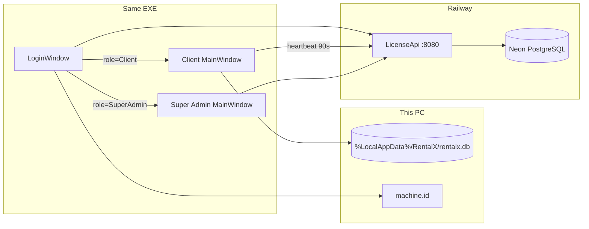
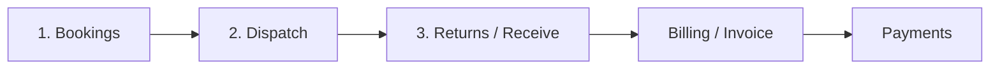

# RentalX

WPF rental-operations desktop app with per-PC licensing. Clients run bookings locally on **SQLite**; access is gated by **`RentalX.LicenseApi`** (hosted on Railway, Neon PostgreSQL). The same EXE also hosts the **Super Admin** shell for approvals, clients, and licenses.

| Piece | Role |
|-------|------|
| `RentalX` | Client desktop app (WPF WinExe) |
| `RentalX.Admin` | Super Admin UI + shared `LicenseApiClient` (library, not a separate EXE) |
| `RentalX.LicenseApi` | ASP.NET Core minimal API — auth, serials, licenses, heartbeat |

**Default API:** `https://rentalx-production.up.railway.app`  
**Local API:** `http://localhost:5159`

---

## Architecture at a glance



**Two databases, two jobs**

| Store | Where | What it holds |
|-------|--------|----------------|
| Client SQLite | `%LocalAppData%\RentalX\rentalx.db` | Customers, inventory, bookings, payments, expenses, company settings, local login account |
| License Postgres | Neon (Railway) | Super admins, clients, client users, serial registrations, licenses, activations, vendor payments, sessions |

The desktop app does **not** sync rental business data to the cloud. The API only controls **who may use the app on which PC**.

---

## Code flow (startup → shell)

Entry point: `RentalX/App.xaml.cs` → `OnStartup`.

1. **DI** — registers EF `AppDbContext`, repositories, services, ViewModels, `LoginWindow`, client `MainWindow`, Admin `MainWindow`.
2. **Local DB** — create/open SQLite → `DatabaseInitializer.Initialize` → ensure default local account.
3. **Optional CLI** (then exit): `--marketing-pdf`, `--delivery-guide`, `--brochure-pdf`.
4. **Login** — `LoginWindow` / `LoginViewModel`:
   - Machine serial from `MachineIdService` (`%LocalAppData%\RentalX\machine.id`) — used **internally** only (not shown on the login UI).
   - **Apply for Access** → `POST /api/serial/apply`
   - **Sign In** → `POST /api/auth/login` with username, password, serial
5. **Route by role** (`ShowShellForRole`):
   - **Client** → `RentalX.Views.MainWindow` + start `ClientAccessMonitor`
   - **Super Admin** → `RentalX.Admin.Views.MainWindow`
6. **Sign-out** — session events close the shell, stop the monitor, return to login.

```
App.OnStartup
  → SQLite init
  → LoginWindow
       → API login / apply
       → Client shell  (+ heartbeat)
       → or Admin shell
```

---

## Client rental workflow

Navigation is defined in `MainViewModel` / `NavigationService`. Core business logic lives in `RentalOperationsService`.



| Step | Page | What happens |
|------|------|----------------|
| 1 | **Bookings** | Pick customer, add inventory lines. Amount ≈ daily rate × qty × days. Status → Confirmed. Stock stays in warehouse. |
| 2 | **Dispatch** | Hand items out. Confirmed → Dispatched; available qty decreases. |
| 3 | **Returns** | Bring items back. Late/early settlement, optional manual adjust, settle balance, print invoice PDF. |
| — | **Inventory** | Item master + daily rates + stock. |
| — | **Customers** | Customer master. |
| — | **Billing / Payments** | Invoices and collecting remaining balance. |
| — | **Dashboard / Reports / Expenses / Settings / Staff** | KPIs, QuestPDF reports, costs, company profile, local staff directory. |

**Booking statuses** (`BookingStatus`): Pending → Confirmed → Dispatched → Returned (also Overdue, Cancelled).

PDFs (QuestPDF) typically land under:

- `Documents\RentalX\Invoices\`
- `Documents\RentalX\Reports\`
- (CLI) `Documents\RentalX\Marketing|Guides|Brochure\`

> On many PCs, **Documents** is OneDrive: `...\OneDrive\Documents\RentalX\`.

---

## Local SQLite (client)

| Item | Detail |
|------|--------|
| Path | `%LocalAppData%\RentalX\rentalx.db` |
| Context | `RentalX/Data/AppDbContext.cs` (singleton in DI) |
| Init | `RentalX/Data/DatabaseInitializer.cs` — `EnsureCreated` + light schema patches |

**Main tables**

| Table | Purpose |
|-------|---------|
| `Customers` | Customer master |
| `InventoryItems` | Stock + daily rate |
| `Bookings` / `BookingLines` | Orders and line items |
| `Payments` | Money against bookings |
| `Expenses` | Business expenses |
| `Users` (`AppUser`) | Staff directory (local) |
| `CompanySettings` | Shop name, GST, currency, footer (reports/invoices) |
| `LoginAccounts` | Local credentials (also used after platform client login) |

On first run, a local seed account may be created (`admin` / `RentalX@123` in `AuthService`) — change it in **Settings**. Platform login is still required against the License API for normal Client / Super Admin use.

---

## License API (cloud)

| Item | Detail |
|------|--------|
| Project | `RentalX.LicenseApi` |
| Host | Railway (`Dockerfile`, listen **8080**) |
| DB | Neon PostgreSQL (`DATABASE_URL` / `RENTALX_LICENSE_DB` / `Database:ConnectionString`) |
| Local alt | `Database:Provider=Sqlite` → `%LocalAppData%\RentalX\LicenseServer\rentalx-license.db` |
| Code map | Almost all routes in `Program.cs`; services under `Services/` |

### Auth model

- Bearer tokens (~12h) stored as sessions (`AdminSessions` / `ClientSessions`).
- **Super Admin** — `AdminUsers`; optional PC lock via `AdminSerials`.
- **Client** — `ClientUsers` tied to a `Client` + active `License` + **Approved** `SerialRegistration` for that machine.
- **Heartbeat** — Client shell polls `GET /api/auth/access` about every **90s** (`ClientAccessMonitor`). Deactivate / revoke / reject → force logout.

### Important endpoints

| Method | Route | Who | Purpose |
|--------|-------|-----|---------|
| POST | `/api/auth/login` | Public | Super Admin or Client login (+ serial) |
| POST | `/api/auth/logout` | Auth | Revoke session |
| GET | `/api/auth/access` | Client | Heartbeat / still allowed? |
| POST | `/api/serial/apply` | Public | New PC access request |
| GET | `/api/serial/status` | Public | Registration status for a serial |
| * | `/api/admin/*`, `/api/clients`, `/api/licenses`, … | Super Admin | Catalog, approve serials, deactivate, etc. |
| GET | `/health`, `/api/health/db` | Public | Liveness / DB check |

Default Super Admin seed (change in production): `superadmin` / `SuperAdmin@123` (`DbSeeder`).

Client ↔ API HTTP layer: `RentalX.Admin/Services/LicenseApiClient.cs`  
Default base URL: `RentalX.Admin/Services/LicenseApiDefaults.cs`

---

## Super Admin (same EXE)

After login as Super Admin:

| Area | Role |
|------|------|
| **Requests (Serials)** | Approve / reject / configure PC access applications |
| **Clients** | Create / edit / deactivate / reactivate businesses |
| **Licenses** | Issue, extend, revoke |
| **Payments** | Vendor-side payment records (API DB, not client SQLite) |
| **Dashboard** | Stats + DB health |
| **Account** | Change Super Admin credentials; manage admin PCs |

Deactivating a client or revoking a serial makes the desktop app sign the user out on the next heartbeat (or sooner when gated actions call `EnsureAccessAsync`).

---

## Folder map

```
RentalX.sln
README.md
installer/RentalX.iss          # Inno Setup → publish/RentalX-Setup.exe
publish/                       # Build + installer output (local)

RentalX/                       # Client WPF
  App.xaml.cs                  # DI, SQLite, login/shell routing
  Data/                        # AppDbContext, DatabaseInitializer, Repositories
  Models/                      # Domain + BookingStatus, etc.
  Services/                    # Navigation, Auth, Session, RentalOperations, PDFs
  Services/Licensing/          # MachineId, ClientAccessMonitor
  ViewModels/  Views/  Themes/ Assets/

RentalX.Admin/                 # Embedded Super Admin
  Services/LicenseApiClient.cs
  ViewModels/  Views/

RentalX.LicenseApi/            # Hosted API
  Program.cs
  Data/LicenseDbContext.cs, DbSeeder.cs
  Services/  Models/  Dtos/
  Dockerfile
```

---

## Run locally

**License API**

```bash
dotnet run --project RentalX.LicenseApi --launch-profile http
```

**Desktop app**

```bash
dotnet run --project RentalX/RentalX.csproj -c Release
```

Point login at `http://localhost:5159` when testing against a local API (or leave the Railway URL for production).

**Publish installer**

```bash
dotnet publish RentalX/RentalX.csproj -c Release -r win-x64 --self-contained true -o publish/RentalX -m:1
# then compile installer/RentalX.iss with Inno Setup 6 → publish/RentalX-Setup.exe
```

---

## Typical end-to-end story

1. New customer installs `RentalX-Setup.exe`.
2. On first open they **Apply for Access** (company details; serial sent quietly to the API).
3. Super Admin **approves** the serial, creates/links **Client** + **License** + login credentials.
4. Customer **signs in** → Client shell → local SQLite for day-to-day rentals.
5. If Super Admin **deactivates** them, heartbeat forces logout on that PC.

---

## Tech stack

- .NET 8, WPF, CommunityToolkit.Mvvm  
- EF Core + SQLite (client) / Npgsql (API)  
- QuestPDF (invoices, reports, CLI guides)  
- Railway + Docker + Neon for License API  
- Inno Setup for Windows installer
